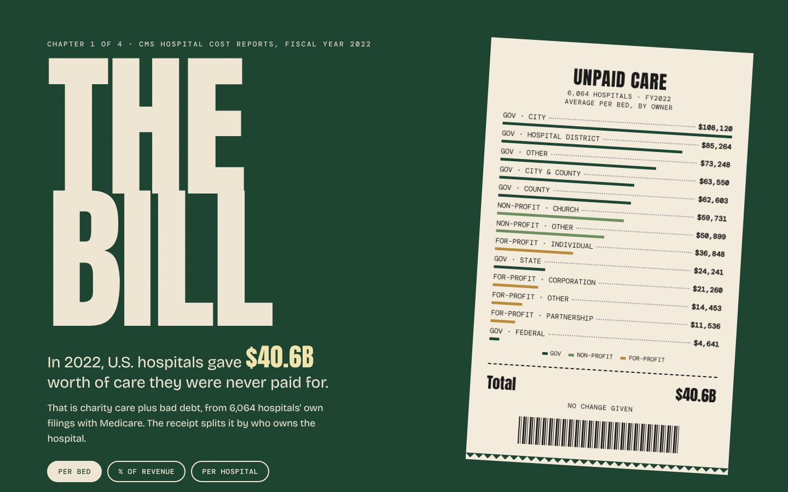
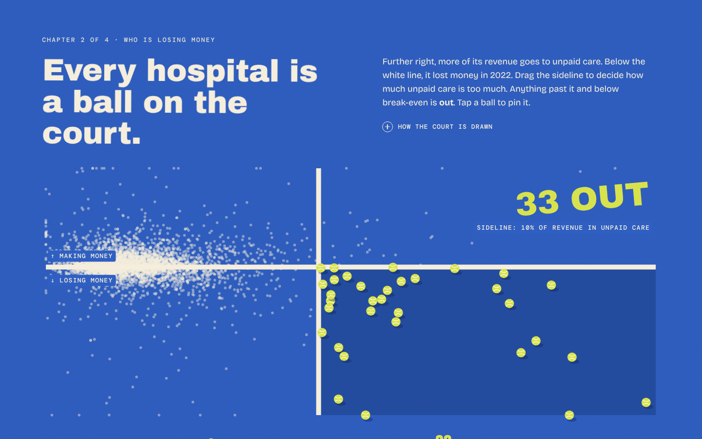
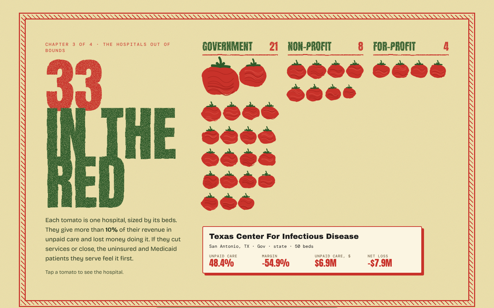

# Who Pays? A hospital cost explorer

An interactive story about the care hospitals give and never get paid for, built on the 2022 CMS Hospital Provider Cost Report (the financial filing every Medicare-certified hospital sends in each year). It runs as four poster-style chapters:

1. **The Bill:** $40.6 billion in unpaid care, printed as a receipt itemized by who owns the hospital. Switch between per bed, % of revenue and per hospital.
2. **Out of bounds:** every hospital is a ball on a tennis court. The horizontal line is break-even and the sideline is how much unpaid care is too much. Drag the sideline and the hospitals that are past it and losing money turn into tennis balls.
3. **In the red:** those hospitals as hand-drawn tomatoes, one per hospital, sized by beds and grouped by owner. Tap one to see its numbers.
4. **441.:** only 441 of 6,064 hospitals report any health IT assets. Each dot is a hospital, grouped by state.

The state picker at the bottom of the screen follows you through the story and redraws every chapter. The sideline you set on the court carries into chapter 3. Almost everything moves when you touch it: receipt lines open to show the top hospitals, the receipt tilts and flips over, balls spin and pin, tomatoes wobble, state tiles and the closing cards flip, and each chapter has a "how this is counted" note that opens.

Built with Flask and pandas, with the charts drawn in plain SVG and JavaScript. Originally my final project for BIS 634 (Computational Methods for Informatics) at Yale, later rebuilt as a story.





## Run it

```bash
pip install -r requirements.txt
python app.py
```

Then open http://127.0.0.1:5000. The cleaned data ships with the repo, so there is nothing else to download.

To check the API without opening a browser:

```bash
python tests/check_api.py
```

## What's in the data

[CMS Hospital Provider Cost Report](https://data.cms.gov/provider-compliance/cost-report/hospital-provider-cost-report), fiscal year 2022: 6,064 hospitals across 50 states, DC and four territories, 117 columns. Public domain.

- `data/raw/` is the file as downloaded from CMS.
- `data/HospitalProviderCostReport_DataFrame_clean.csv` is what the app reads.
- `notebooks/data_cleaning.ipynb` turns one into the other. The only change is trimming ZIP codes to 5 digits. Rerunning it gives a byte-identical file.

Measures the dashboard uses:

- **Uncompensated care burden:** cost of uncompensated care / total patient revenue
- **Net margin:** net income / total patient revenue
- **At risk:** burden above a cutoff you choose (5% to 25%) and a negative margin
- **HIT share:** HIT designated assets / total fixed assets. Only 441 hospitals report any HIT assets, so this section covers a small, self-selected group.

## How the court is drawn

- Left to right is unpaid care as a % of patient revenue, on a square-root scale so the long tail (up to 50%) fits.
- Up and down is net margin, clipped to between -60% and +40%. A few hospitals with extreme losses sit on the bottom edge; their tooltip says they are off the court.
- "Out" means unpaid care above the sideline and a negative margin, the same rule as `/api/risk`.

## API

All endpoints take an optional `state` (two-letter code).

- `GET /api/summary_stats`: hospital counts, median beds, ownership mix, missing-data counts
- `GET /api/ownership?normalize_by=beds`: `beds`, `revenue` or `none`
- `GET /api/scatter?min_beds=100`: one point per hospital with burden and margin
- `GET /api/hit_capital?metric_type=hit_share`: `hit_share`, `hit_per_bed`, `hit_vs_assets` or `state_comparison`
- `GET /api/risk?threshold=10`: at-risk hospitals for a burden cutoff
- `GET /api/hospitals`: every hospital as a compact row (what the page itself uses)
- `GET /api/states`, `GET /api/analyses`

## Project layout

```
app.py                  Flask routes
backend/queries.py      loads the CSV, adds ownership labels, state filter
backend/analyses.py     the four analyses, returned as plain rows
templates/index.html    the story page
static/js/story.js      builds every chapter from /api/hospitals
static/css/story.css    styles; fonts are Anton, Archivo, Archivo Black, Bricolage Grotesque and Fraunces (all OFL)
notebooks/              data cleaning
tests/check_api.py      calls every endpoint and checks the at-risk counts against the raw CSV
```

## Changes from the original class version

The page is now a story instead of a grid of charts, and the API returns data instead of finished Plotly figures. That made it possible to:

- compute the at-risk list on the server (`/api/risk`) instead of reading it back out of a chart in the browser
- color bars by broad ownership; the old color map never matched the type names, so every bar fell back to default colors
- report the real median bed count (the old summary returned the mean under the median label)

Every number the original analyses produced was checked against the new API for all states and five individual states, and they match. The numbers the page computes in the browser (receipt lines, totals, out-of-bounds counts) were also checked against the API for all states, Texas, California and New York at three sideline settings, and they match.

## Limitations

- One year of data, so nothing here says whether a hospital's situation is getting better or worse.
- Margins use patient revenue as the denominator and do not include other income such as investments or donations.
- Cost report fields are self-reported and some are missing (243 hospitals have no patient revenue, for example). Hospitals missing a measure are left out of that chart.

## Author

Caprice Culkin, MS Health Informatics, Yale School of Public Health
