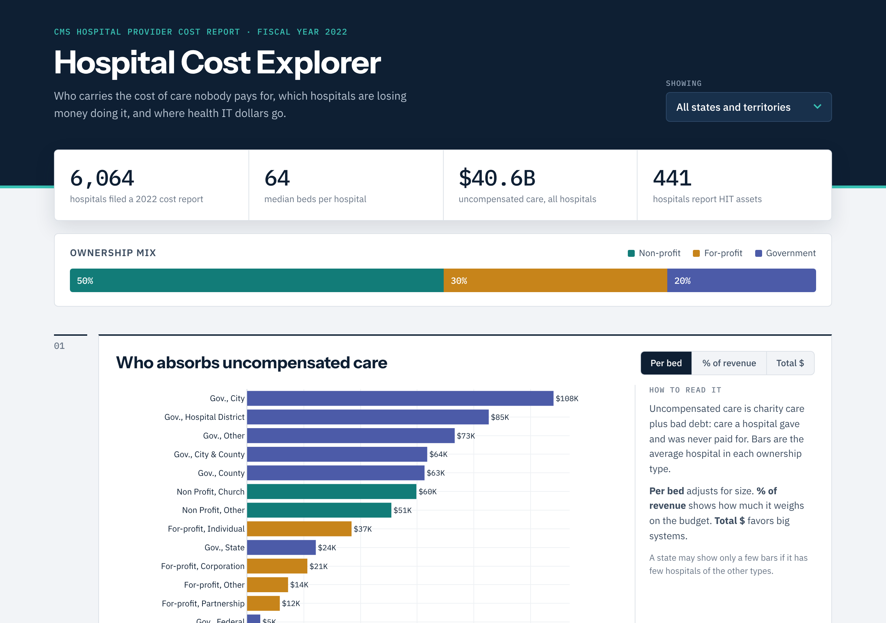
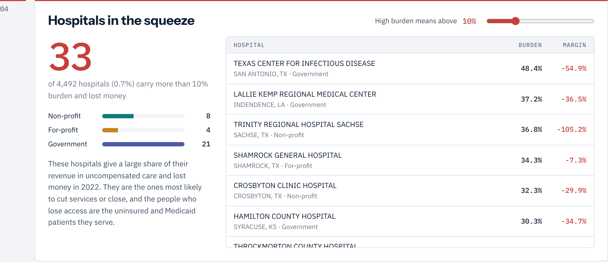

# Hospital Cost Explorer

An interactive dashboard and JSON API over the 2022 CMS Hospital Provider Cost Report, the financial filing every Medicare-certified hospital sends in each year. It looks at three questions:

1. **Who absorbs uncompensated care?** Charity care plus bad debt, compared across 13 ownership types.
2. **Who is losing money doing it?** Each hospital's uncompensated care burden against its net margin, plus a list of hospitals that are both high-burden and in the red.
3. **Where does health IT money go?** Assets hospitals set aside for health information technology, by ownership type and state.

Built with Flask, pandas and Plotly.js. Originally my final project for BIS 634 (Computational Methods for Informatics) at Yale, later rebuilt with a new front end.



## Run it

```bash
pip install -r requirements.txt
python app.py
```

Then open http://127.0.0.1:5000. The cleaned data ships with the repo, so there is nothing else to download.

To check the API without opening a browser:

```bash
python tests/check_api.py
```

## What's in the data

[CMS Hospital Provider Cost Report](https://data.cms.gov/provider-compliance/cost-report/hospital-provider-cost-report), fiscal year 2022: 6,064 hospitals across 50 states, DC and four territories, 117 columns. Public domain.

- `data/raw/` is the file as downloaded from CMS.
- `data/HospitalProviderCostReport_DataFrame_clean.csv` is what the app reads.
- `notebooks/data_cleaning.ipynb` turns one into the other. The only change is trimming ZIP codes to 5 digits. Rerunning it gives a byte-identical file.

Measures the dashboard uses:

- **Uncompensated care burden:** cost of uncompensated care / total patient revenue
- **Net margin:** net income / total patient revenue
- **At risk:** burden above a cutoff you choose (5% to 25%) and a negative margin
- **HIT share:** HIT designated assets / total fixed assets. Only 441 hospitals report any HIT assets, so this section covers a small, self-selected group.

## The dashboard

One state filter at the top drives every section. Each section has its own controls and a short note on how to read it.

- **01 Ownership:** average uncompensated care per bed, as a % of revenue, or in total dollars. Bars are colored by broad ownership (non-profit, for-profit, government).
- **02 Burden vs bottom line:** one dot per hospital. You can set a minimum bed count to compare similar-sized hospitals. The view is clipped to the middle 98% of hospitals so a few extreme values do not squash everything else.
- **03 Health IT capital:** HIT as a share of fixed assets, per bed, against total assets (log scale, with a straight-line fit), or the top 15 states.
- **04 Hospitals in the squeeze:** a slider for the burden cutoff, the count of at-risk hospitals by ownership, and the list itself.



## API

All endpoints take an optional `state` (two-letter code).

- `GET /api/summary_stats`: hospital counts, median beds, ownership mix, missing-data counts
- `GET /api/ownership?normalize_by=beds`: `beds`, `revenue` or `none`
- `GET /api/scatter?min_beds=100`: one point per hospital with burden and margin
- `GET /api/hit_capital?metric_type=hit_share`: `hit_share`, `hit_per_bed`, `hit_vs_assets` or `state_comparison`
- `GET /api/risk?threshold=10`: at-risk hospitals for a burden cutoff
- `GET /api/states`, `GET /api/analyses`

## Project layout

```
app.py                  Flask routes
backend/queries.py      loads the CSV, adds ownership labels, state filter
backend/analyses.py     the four analyses, returned as plain rows
templates/index.html    the page
static/js/app.js        fetches each analysis and draws it with Plotly.js
static/css/style.css    styles; fonts are IBM Plex and Instrument Sans (OFL)
notebooks/              data cleaning
tests/check_api.py      calls every endpoint and checks the at-risk counts against the raw CSV
```

## Changes from the original class version

The API now returns data instead of finished Plotly figures, and the page draws the charts itself. That made it possible to:

- compute the at-risk list on the server (`/api/risk`) instead of reading it back out of a chart in the browser
- color bars by broad ownership; the old color map never matched the type names, so every bar fell back to default colors
- report the real median bed count (the old summary returned the mean under the median label)

Every number the original analyses produced was checked against the new API for all states and five individual states, and they match.

## Limitations

- One year of data, so nothing here says whether a hospital's situation is getting better or worse.
- Margins use patient revenue as the denominator and do not include other income such as investments or donations.
- Cost report fields are self-reported and some are missing (243 hospitals have no patient revenue, for example). Hospitals missing a measure are left out of that chart.

## Author

Caprice Culkin, MS Health Informatics, Yale School of Public Health
